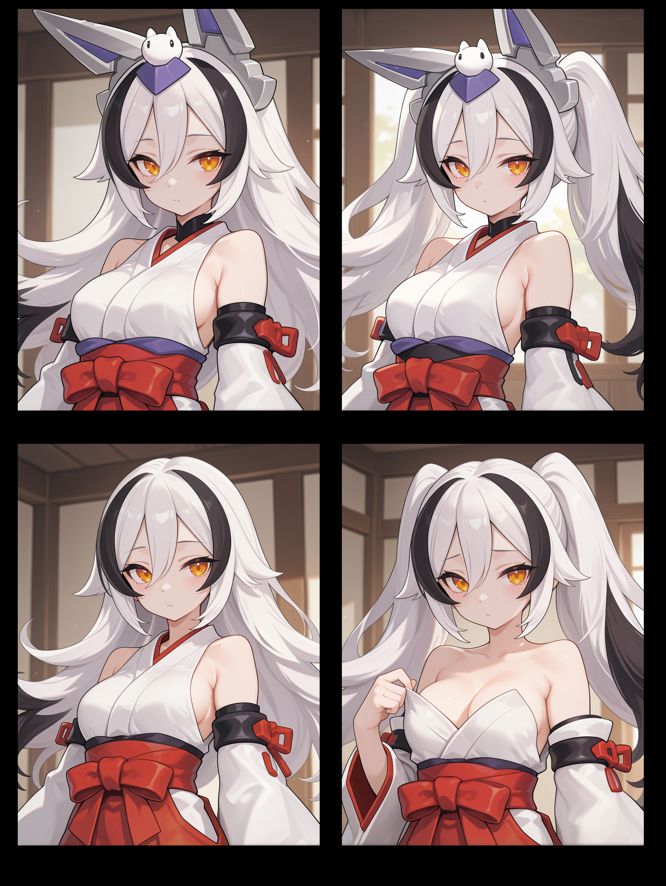
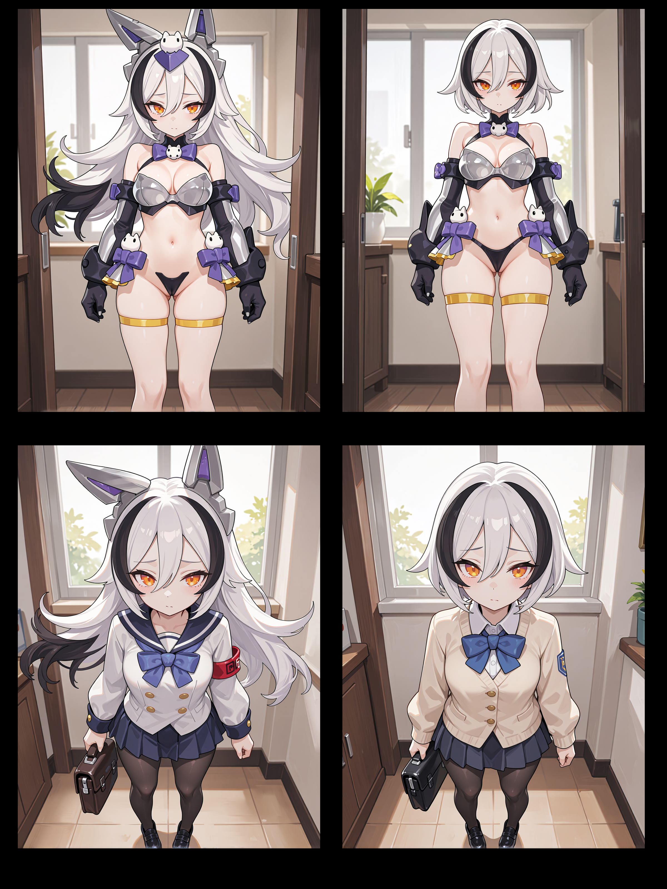
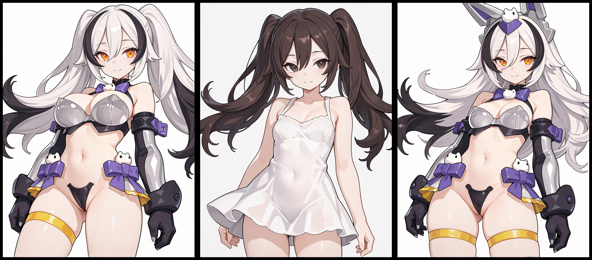
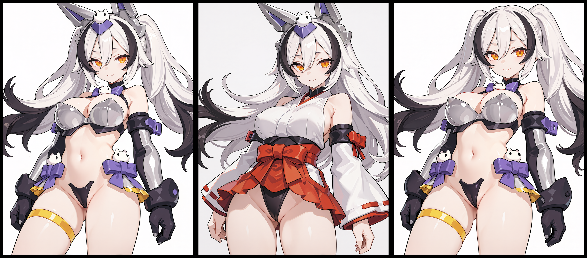
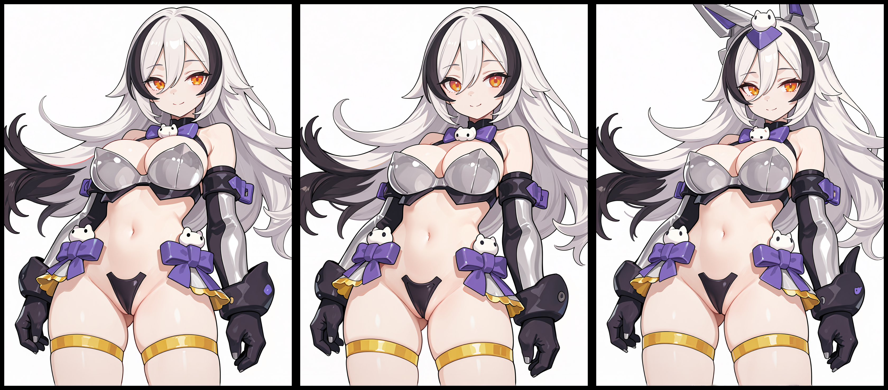
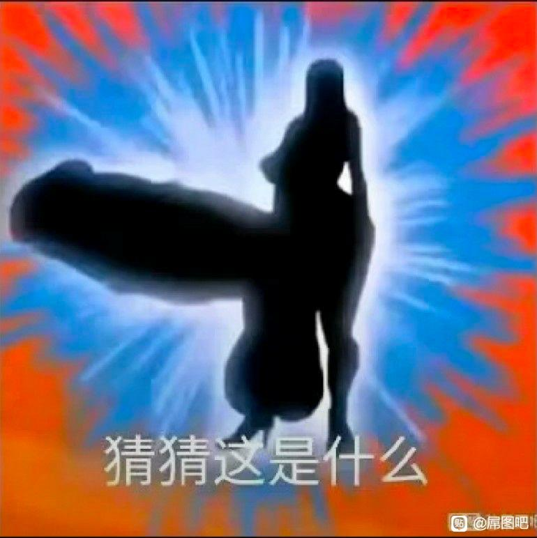
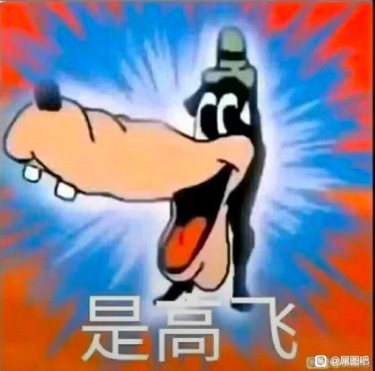

# 角色身份识别的分层判据：单立绘 LoRA 的验收与自查

因为一直苦于无法判断一个角色 LoRA 炼成与否，我把社区里能找到的相关文章都翻了一遍，发现它们给出的建议高度一致：把角色特征分成"固定的"和"可以变的"两类。发型、发色、瞳色、耳形属于要固定的；表情、姿势、背景、构图属于可以变的。

这个分法本身没什么问题，问题在于它没有回答我真正想问的：**为什么是这几个，"固定"要固定到什么程度，如果其中有一个学偏了，算不算失败。**

更麻烦的是，这些文章的作者大多是生成者本人。而生成者本人看不出自己的图偏了——我自己就是这样，单张看每张都像，十张摆一起才看出问题。

单立绘炼 LoRA 时这个问题更突出。没有二创、没有多视角，手上只有一张立绘，此时既不能把特征学死，又不能学不到特征。那到底该拿什么标准来界定最终成果？

结论放在最前面，便于直接使用。凡是我没验证过的地方，都会标出来。

---
## 结论

以寿屋的 punimofu 狼（下称"狼"）与它的异色产品 punimofu 银狼为例。这是示例，具体要素要按你的角色重新列，但判据本身是通用的。

如果你要炼的是"狼"这个类别（含各种异色），需要保留：

- **头部穿戴物的几何构型**：即角色头部区域的饰品
- **角色眼部（瞳孔、眼型）的几何构型**：即角色的眼型
- **头发发型的几何构型**：即角色的发片构型
  - 需要注意的是，像狼这样构造简单的挑染，其分色方式也被认为是发片的构型

如果你只炼原色狼，或者只炼某一个异色（即"个体"），在上面三条之外再加：

- **配色（含发色）**：即角色服装、头发、瞳色等各种配色要素

以下特征是可选项：

- **非头部穿戴物**：即角色除了头部区域以外的服装配饰
- **非头部角色本体**：即角色的体态（身高、年龄、乳量等等）

【注意】
以上说的是"对认识这个角色的人而言"。不认识的人看到什么都是"找不同"，跟身份判断无关。
“认识”指的是“知道这个角色的名称以及其所对应的形象”，并不需要你实际去看这个角色的故事等等

---
### 自查消融实验

#### A. 元信息

- 测试目标：判断银狼的 LoRA 是否保留"可识别身份"
- 被测对象：
	- lora 名称：Yeon_ginran_v10Step2_epoch15.safetensors（未发布）
	- 训练集来源：
		- 官方原始立绘及其裁剪后的局部图
		- 闭源模型生成的三视图及其裁剪后的局部图
		- 经过Step1过拟合lora生成的数据集
	- 参考图清单
		- [官方原始立绘](images/原立绘.jpg)(唯一来源)
- 测试环境：
	- 底模：
		- 训练底模：Anima 1.0
		- 生图底模：MiaomiaoHarem_anima16 + turbo
			- 经测试，底模不同只影响基础画风，不对角色特征产生影响（自测断言、未正式验证）
	- 采样参数
		- noise_seed：23334
		- sampler：dpmpp_2m_sde
		- scheduler：beta57
		- steps：8
		- latent：1.5mpx，3:4
- 测试日期、测试者
	- 2026-10
	- Yeon

#### B. 受测人员与测试规则

##### 观察者设置（最容易漏、也最决定成败）

- 观察者：Yeon（生成者本人）
- 观察者类型：`生成者本人`
- 每组人数：1人
- 盲测：
	- 是否告知图像同源（这组图来自同一 lora / 同一消融实验）：是
	- 是否告知实验条件（哪张是基线、哪张被剥离了什么）：是
	- 是否告知预期答案（哪几张应被认成目标角色）：是
	- 任务必告知：目标角色名（问法需给出）
- 问法固定：
	- 单图"这是谁"；
	- 多图"这 N 张里，哪几张是 X？（多选，允许"全部/都不是"）"；
	- **不用**"是否同一人"
- 降级模式：**单观察者模式**。该模式只能测"特征唯一性的相对方向"，不能测"绝对置信度"，且结论要标"强先验污染，需外部观察者复核"

##### 施测规则

1. **随机化**：打乱顺序，且**不能按条件编号排**（否则 #1 基线先看会锚定）。用随机数决定发送顺序，记录顺序号。
2. **分批分组**：组数按 E1 方案（配色可做→4 组；不可做→3 组），每组 3 张，其余单选
3. **剥离有效性确认**：每张出图后人工确认该要素确实被剥掉了（比如"头饰确实消失"），记在备注；确认不了的条件作废，不硬算。这是单干最容易偷懒、也最容易毁数据的一步。
4. **任务话术固定**：`"这 N 张图里，哪几张是 [角色名]？"`（多选，允许"全部/都不是"），逐张记录判定 + 置信度，不给"是否同一人"这种问法。

#### C1. 2×2 消融对比

|          | 原发型  | 修改发型 |
| -------- | ---- | ---- |
| **去掉头饰** | 完全确定 | 比较确定 |
| **原头饰**  | 不太确定 | 不确定  |

|          | 原头饰发型 | 修改头饰发型 |
| -------- | ----- | ------ |
| **原服饰**  | 完全确定  | 不太确定   |
| **修改服饰** | 完全确定  | 不确定    |

#### C2.  剥离矩阵

- 类别层：**头部穿戴物的几何构型、角色眼部（瞳孔、眼型）的几何构型、头发发型的几何构型**
- 个体层：角色设计元素中的**配色（含发色）**、**非头部穿戴物**以及**非头部角色本体**

| 目标                         | 对应 3.1     | 需要什么条件                                |
| -------------------------- | ---------- | ------------------------------------- |
| 类别层要素的**联合充分性**：哪些组合仍能触发识别 | 观点四、预言 3   | 类别层 3 要素全因子 2³ = 8 张                  |
| 类别层要素的**交互**（纠缠是否超加性）      | 观点八、观点五-5  | 同上（8 张里含 3 个双剥离 + 1 个三剥离）             |
| 个体层要素**不改变本体归属**           | 观点五-4、预言 3 | 类别层全保留时单剥 3 项（服装、配色、本体）              |
| **跨层补偿**：类别层崩了，个体层能不能拉回    | 观点五-5、预言 6 | 类别层全剥 + 个体层全剥 vs 类别层全剥 + 个体层保留（差 1 张） |
| 发色剥离（个体转移）                 | 观点五-1      | 1 张单剥发色                               |

| #      | 条件      | 类别层      | 个体层   | 用途            | （问题：是否是XX）预期  |
| ------ | ------- | -------- | ----- | ------------- | ------------- |
| 1      | 基线      | 全保留      | 全保留   | 锚点            | 是             |
| 2      | 单剥头饰    | 剥头饰      | 全保留   | 必要性/强度        | 不太确定          |
| 3      | 单剥眼型    | 剥眼型      | 全保留   | 必要性/强度        | 不太确定          |
| 4      | 单剥发型    | 剥发型      | 全保留   | 必要性/强度        | 很可能是          |
| 5      | 单剥发色    | 全保留      | 剥发色   | 个体转移（观点五-6、预言 3） | 不是（但判为狼） |
| 6      | 剥头饰+眼型  | 双剥       | 全保留   | 交互            | 不确定           |
| 7      | 剥头饰+发型  | 双剥       | 全保留   | 交互            | 不确定           |
| 8      | 剥眼型+发型  | 双剥       | 全保留   | 交互            | 不太确定/不确定      |
| 9      | 三剥      | 全剥       | 全保留   | 联合下限          | 不确定           |
| 10     | 单剥服装    | 全保留      | 剥服装   | 个体层不改变本体归属    | 是             |
| 11     | 单剥配色    | 全保留      | 剥配色   | 个体层不改变本体归属    | 很可能是          |
| 12     | 单剥本体    | 全保留      | 剥本体   | 个体层不改变本体归属    | 是             |
| 13     | 全剥离     | 全剥       | 全剥    | 跨层对照          | 不是            |
| ~~14~~ | ~~干扰图~~ | ~~其他角色~~ | ~~—~~ | ~~特异性~~       | ~~不是~~        |

| 组      | 内容                          | 原因                                         | 期望                         |
| ------ | --------------------------- | ------------------------------------------ | -------------------------- |
| 组 1    | #1 基线、#2 单剥头饰、#6 双剥头饰+眼型    | 1 正向 + 2 负向；单剥头饰 vs 含头饰双剥，看眼型附加            | 基线：是；头饰：降档；双剥：更差           |
| 组 2    | #10 单剥服装、#4 单剥发型、#7 双剥头饰+发型 | 1 正向 + 2 负向；单剥发型 vs 含发型双剥，看头饰附加；复现既往 A 组数据 | 服装：是；发型：降档；双剥：不确定          |
| 组 3    | #12 单剥本体、#9 三剥、#13 全剥       | 1 正向 + 2 负向；跨层对照（三剥 vs 全剥）                 | 本体：是；三剥：不确定；全剥：完全不像        |
| 独立 3 张 | #3 单剥眼型、#8 双剥眼型+发型、#5 单剥发色  | 眼型剥离可靠性差，两张放独立便于丢弃；发色检验个体转移             | 眼型两张：不太确定；发色：不是（但判为狼） |

> 注意，图中对于眼型的解耦程度较差，只能勉强看出圆眼与吊梢的区别

C2在生成数据集的时候没有进行自测，原因在于先验过强，以至于我提前知道什么图需要反应什么样的答案。

在隔了10天后重新测试，现在虽然存在理论先验干扰，但是忘记了每张图对应的理想答案。现在测试结果如下：

**重测结果**（观察者为生成者本人，强先验 + 知情，按方法论 4 只作方向性记录，不作特征唯一性的独立测量）

| 组 | 条件 # | 条件 | 预期 | 实测 | 判定档 | 符预期 |
| --- | --- | --- | --- | --- | --- | --- |
| 1 | #1 | 基线 | 是 | 是 | 原版 | 是 |
| 1 | #2 | 单剥头饰 | 降档 | 不太确定 | 造型变体 | 是（降幅大于预期） |
| 1 | #6 | 双剥头饰+眼型 | 更差 | 不太确定 | 造型变体 | 否（未比单剥更差） |
| 2 | #10 | 单剥服装 | 是 | 是 | 原版 | 是 |
| 2 | #4 | 单剥发型 | 降档 | 比较确定 | 造型变体 | 是 |
| 2 | #7 | 双剥头饰+发型 | 不确定 | 不太确定 | 造型变体 | 是 |
| 3 | #12 | 单剥本体 | 是 | 是 | 原版 | 是 |
| 3 | #9 | 三剥 | 不确定 | 不太确定 | 造型变体 | 基本符合（偏乐观一档） |
| 3 | #13 | 全剥 | 不是（完全不像） | 不是 | 类别外 | 是 |
| 散 | #3 | 单剥眼型 | 不太确定 | 不是 | 类别外 | 否（见注 4） |
| 散 | #5 | 单剥发色 | 不是（但是是狼） | 不是（但是是狼） | 同类其他个体 | 是 |
| 散 | #8 | 双剥眼型+发型 | 不确定 | 不是 | 类别外 | 否（见注 4） |

> **两点说明**：
> 1. 「实测」一栏里，"是 / 不是"是**归属判定**的结论，"完全确定 / 比较确定 / 不太确定 / 不确定"是**置信度**的档位，二者不是同一个量，实验记录时应分两栏填写。本表沿用原始记录原样，未做换算。
> 2. 「判定档」一栏按方法论 7 的五档补记，**非实验当时记录**。「符预期」按表中现有预期值判定，**未修改任何一条预期值**；部分预期值是否定得偏松，见注 4。

#### 重测读出的四条结果

1. **#5 单剥发色：类别层保留、个体层失效。** 实测「不是（但是是狼）」，即判为非银狼、但仍是狼。这与预言 3 的预期一致（单剥发色应致个体转移、类别归属不变），支持观点五-6（发色归个体层）。证据等级只能给 **[个案]**——观察者为生成者本人，强先验 + 知情，按方法论 4 需弱先验盲测者复核后方可升级。

2. **#13 全剥判「不是」，与双剥停在「不太确定」合起来，给兜底划出了下界。** 观点六-3.2 的兜底此前为 [推定]：强先验会把结果拉回已有的类，使「不确定」不等于「完全不像」。本实验里双剥（#6、#7）停在「不太确定」，而全剥（#13，类别层与个体层皆剥净）落到了「不是」——说明兜底有下限，剥到全剥这一级即失效。这比笼统地说「兜底存在」更可检验：兜底的边界在双剥与全剥之间。**限定**：全剥与双剥的差别不只在剥离数量，也在全剥同时清空了配色与非头部要素，故该下界究竟由「剥离总量」还是「个体层要素也参与贡献」决定，本实验不能分离，需另设一组「类别层全剥 + 个体层保留」才能判。

3. **#2 单剥头饰的杀伤大于预期。** 预期「降档」、实测「不太确定」，比预期低一档；而 #4 单剥发型实测「比较确定」。二者对照支持观点四-3 的方向性结论：头部穿戴物的剥离影响大于发型。但层内强度的相对大小取自单观察者记录，不能作独立测量。

4. **#3、#8 的「不符预期」，方向是实测比预期更彻底。** 预期写「不太确定 / 不确定」，实测均为「不是」（类别外）。若按观点四，眼型属类别层要素，剥离本应导致类别崩塌、落到类别外，则实测**符合理论**，是预期值定得偏松。此处不改预期值（避免事后改预期），仅记明不符的方向与原因。另需注意：眼型的解耦质量本身较差（图注：只能勉强看出圆眼与吊梢），故这两条的证据力弱于其他条件。

---

## 引例：

情景1：当你在刷贴吧，或是看视频的时候，有人在评论区发了一句"kskbl"，此时会如何回应？
对于知道这个梗的人来说，会马上反应出 kskbl(康神开播了) -> zdjd(真的假的)
而对于不知道这个梗的人来说，会尝试去匹配这几个字母的读音：快手看不了？扩散开爆了？....最终觉得一头雾水

情景2：
 

观察者在视频中首次看到图像的时候，会认为这是大屌扶她。当作者告诉观察者这是高飞后，观察者再次点击该视频时，尽管看起来确实很像大屌扶她，但是此时观察者会知道这是高飞。

同样的情景还有在2020年时流行过一段时间的”我是谁“猜剪影

情景1中，kskbl只对知道这个梗的人生效，不知道这个梗的人无法识别出这里面的含义。对于知道kskbl=康神开播了的人而言，并不意味他们失去了“快手看不了”等可能性组合的认知，而是在该情境下，在他们的候选集中kskbl大概率指向“康神开播了”的组合。同样的，kskbl回应zdjd也是在该情境下，在候选集中所得出的置信度最高的反应范式

而情景2中，尽管剪影特征与实际展示几乎完全不符，但是当观察者知道这个剪影在该视频中的指向对象是高飞后，再次看该视频时会反应出来“哦，这是高飞”。
这是因为当第一次看的时候，观察者通过图中剪影的形状从候选集中进行拼凑，图中的特征大概率指向了“扶她”。而作者向观察者展示了图中实际的结果是高飞，观察者获得并学习到该先验，因此在下一次的类似情景下，“高飞”变成了高概率的结果。而如果作者对视频进行了还原，剪影中的高飞被替换成了其他的角色，观察者在没有看新视频的情况下是无法猜测到换源后的角色的

由此我认为，在一般认知活动中：**特征组合作用于候选集，观察者所处环境约束候选集；候选集中匹配出的唯一结论被认为是特征所指向的对象。** 但是这条断言过于宽泛，不产生任何经验内容。 

更进一步约束到**角色身份**这个细分领域时，断言变为：观察者在**存在特征先验**、且图中**角色设计元素的组合在其候选集内存在唯一匹配结果**的情况下，会触发**身份特征激活行为**；**候选集**受到外部因素影响，且匹配结果越不唯一，置信度越低。

---

本文的结论只覆盖「可识别的身份」这一层。完整论证——观点一至八、7 条验证方法论、9 条可检验预言、8 条未决问题，以及每条结论的证据等级——见 [理论.md](理论.md)；逐条件的测试集与提示词见 [PROMPTS.md](PROMPTS.md)。

本作品采用 [知识共享署名-非商业性使用 4.0 国际许可协议](https://creativecommons.org/licenses/by-nc/4.0/)（CC BY-NC 4.0）授权。
